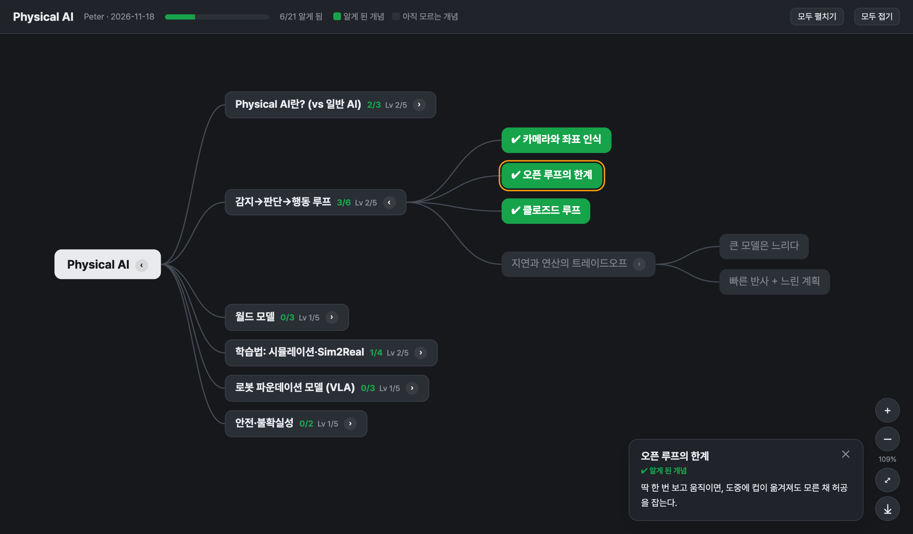

<p align="center">
  
  
  
  
</p>

<h1 align="center">🗺️ learning-map</h1>
<h3 align="center">A mindmap of what you actually learned</h3>

<p align="center">
  The companion to Jane Street's <a href="https://github.com/janestreet/agent_skills">socratic-tutor</a> skill:<br/>
  it turns what you learned into <b>one Markdown file</b> and <b>one clickable, offline HTML mindmap</b>.
</p>

<p align="center">
  Green is what you proved. Gray is what's left. One file you can open anywhere.
</p>

---

<p align="center">
  
</p>

```
$ python3 scripts/render.py examples/PHYSICAL_AI.map.md
examples/PHYSICAL_AI.map.html  (6/21 learned, 6 branches)
```

---

## What It Shows

| Element | Description |
| ------- | ----------- |
| `Root` | The topic you're learning |
| `Branch  3/6  Lv 2/5` | One subskill: concepts learned / total, and its socratic-tutor level |
| `✔ Concept` (green) | Something you showed you know. Click it and a dashed note pops out to its right with a one-line description in your own words. Click again, or anywhere else, to close |
| `Concept` (gray) | Something you don't know yet |
| `›` / `‹` | Click to expand or collapse sub-concepts, to any depth |
| Progress bar | Learned concepts across the whole map |

The map only marks a concept green after you've answered it, predicted it, or explained it yourself. Concepts the tutor only explained stay gray. That's the same bar socratic-tutor uses to raise a level.

### Controls

| Input | Action |
| ----- | ------ |
| Mouse wheel / trackpad pinch | Zoom toward the cursor (20%–300%) |
| Drag the background | Pan |
| `+` `-` `0` | Zoom in, zoom out, fit to screen (the map also opens centered and fitted) |
| `⤓` | Download the whole map as a 2x PNG, every node expanded |
| `모두 펼치기` / `모두 접기` | Expand all / collapse all |

---

## How It Works

The `.map.md` file is the source of truth. The HTML is a build output, so you edit the Markdown and render again.

```markdown
---
title: "Physical AI"
learner: Peter
updated: 2026-11-18
---
# Physical AI

## 감지→판단→행동 루프 [2/5]
- [x] 오픈 루프의 한계 — 딱 한 번 보고 움직이면, 컵이 옮겨져도 모른 채 허공을 잡는다.
- [ ] 지연과 연산의 트레이드오프
  - [ ] 큰 모델은 느리다
```

| Syntax | Meaning |
| ------ | ------- |
| `# X` | Root (map title) |
| `## X [n/5]` | Branch. `[n/5]` is optional |
| `- [x] label — desc` | Learned concept with its description |
| `- [ ] label` | Not yet known |
| 2-space indent | Child concept |

The separator between label and description can be ` — `, ` -- `, or ` :: `.

### Tutoring state

The map file doubles as the tutoring session's saved state. These frontmatter keys hold what the tutor needs to pick up where it stopped. The renderer ignores them.

```markdown
---
title: "Physical AI"
learner: Peter
updated: 2026-11-18
target: "4/5 on every branch"
next_question: "카메라로 1초에 1000번 보고, 매번 거대 AI 모델로 다시 판단하면 완벽한 로봇일까?"
misconceptions: "VLA 입력을 좌표로 생각함 / 한 번 본 로봇이 멈춘다고 했다가 교정됨"
notes: "2번 3/5 승급 조건: closed-loop을 힌트 없이 한 번 더 맞히기"
---
```

| Key | Holds |
| --- | ----- |
| `next_question` | The question waiting for an answer when the session stopped |
| `misconceptions` | Wrong ideas the learner showed, and whether they've been corrected |
| `notes` | Grading notes: what a level-up still needs, which terms the tutor only named |
| `target` | Goal level for every branch |

---

## Installation

In your shell:

```bash
git clone https://github.com/PeterCha90/learning-map ~/.claude/skills/learning-map
```

Use it alongside socratic-tutor:

```bash
git clone https://github.com/janestreet/agent_skills /tmp/agent_skills
cp -R /tmp/agent_skills/socratic-tutor ~/.claude/skills/
```

Then ask your agent "teach me X" and "show my learning map". Any agent that reads the `SKILL.md` format works. Rendering needs only `python3`.

---

## Use With socratic-tutor

socratic-tutor saves progress by printing a block you paste into the next session (`save state` / `resume from:`). With learning-map, the `.map.md` file is that state, so there's nothing to paste.

| socratic-tutor | With learning-map |
| -------------- | ----------------- |
| `save state` prints a block | The tutor updates `TOPIC.map.md` and replies with its path |
| `resume from:` + pasted block | "Continue Physical AI": the tutor reads the map and asks `next_question` |
| Diagnostic every new session | Skipped when the map already exists |
| Progress lives in the chat | Progress lives in a file you can open, diff, and version |

To wire them together, append this to your copy of `socratic-tutor/SKILL.md`. Jane Street doesn't accept changes to their skills and asks people to keep their own copy, so this goes in yours, not upstream.

```markdown
## Persistent state (local addition: learning-map)

When the learning-map skill is installed, the session state lives in a
`<TOPIC>.map.md` file instead of a pasted block. Follow the learning-map skill for
the file format and for rendering.

- Session start: if the topic's `.map.md` exists, read it and resume from it
  (levels, learned concepts, `next_question`, `misconceptions`, `notes`) instead of
  running the diagnostic again. If it does not exist, run the diagnostic, then
  create the file.
- After every level change or concept the learner earns: update the file in the
  same turn, then re-render the HTML.
- Before ending a session: write the pending question to `next_question`.
- "save state" — update the map file and reply with its path. Emit the paste-able
  block only if the user asks for it, e.g. to move to another tool.
- "resume from:" — still accepts a pasted block or a `.map.md` file.
```

Moving to a chatbot that can't read your files? Paste the `.map.md` itself. It carries everything the block did.

---

## Usage

Render a map:

```bash
python3 ~/.claude/skills/learning-map/scripts/render.py path/to/TOPIC.map.md
python3 ~/.claude/skills/learning-map/scripts/render.py path/to/TOPIC.map.md -o out.html
```

Open the `.html` in any browser, VS Code, or Orca. No server, no CDN, no install.

---

## Troubleshooting

| Problem | Solution |
| ------- | -------- |
| A concept doesn't show up | Every concept line needs `[ ]` or `[x]`, and must sit under a `##` branch |
| Children attach to the wrong parent | Use 2 spaces per indent level, no tabs |
| `⤓` does nothing in VS Code's built-in preview | Webviews can block downloads. Open the file in a browser to export |
| Changes in the `.md` don't appear | Run `render.py` again. The HTML doesn't read the `.md` live |
| A new session starts the diagnostic again | Your socratic-tutor copy doesn't have the persistent-state section yet. Add it (see Use With socratic-tutor) |

---

## Project Structure

```
learning-map/
├── SKILL.md                 # Instructions for the agent
├── scripts/
│   └── render.py            # .map.md → self-contained .html (stdlib only)
├── assets/
│   └── template.html        # Mindmap UI: expand, zoom, pan, PNG export
├── examples/
│   ├── PHYSICAL_AI.map.md   # Sample map
│   └── PHYSICAL_AI.map.html # Its rendered output
└── docs/
    ├── preview.png
    └── export.png           # Sample of the ⤓ PNG export
```

---

## License

[MIT](LICENSE)

---

<p align="center">
  Made by <a href="https://github.com/PeterCha90">Peter Cha</a>
</p>
